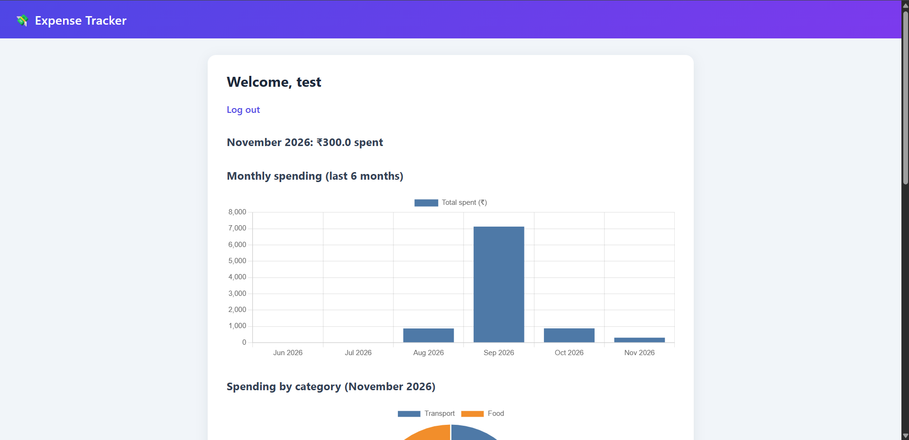
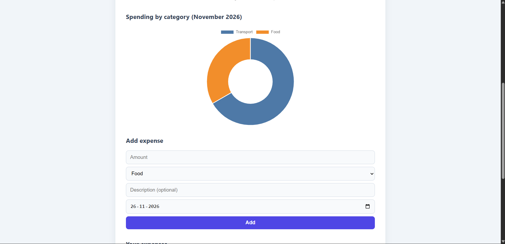
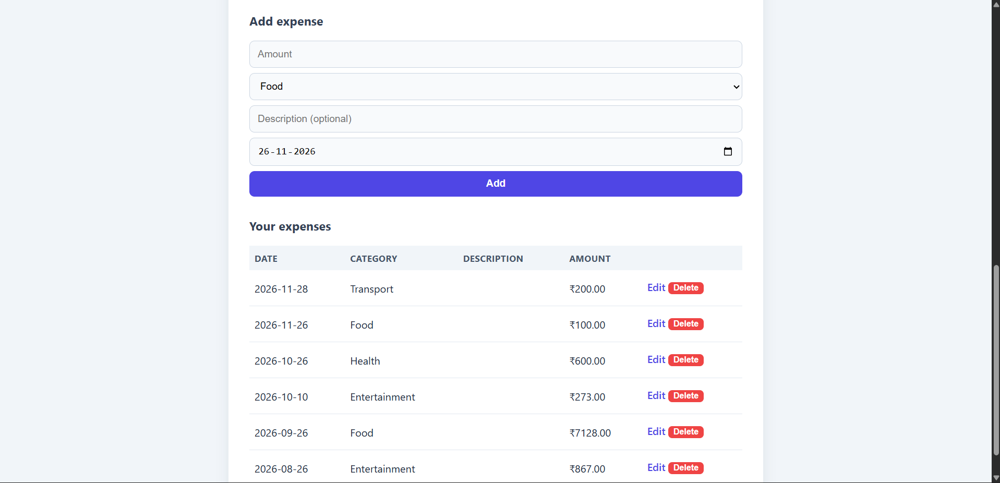
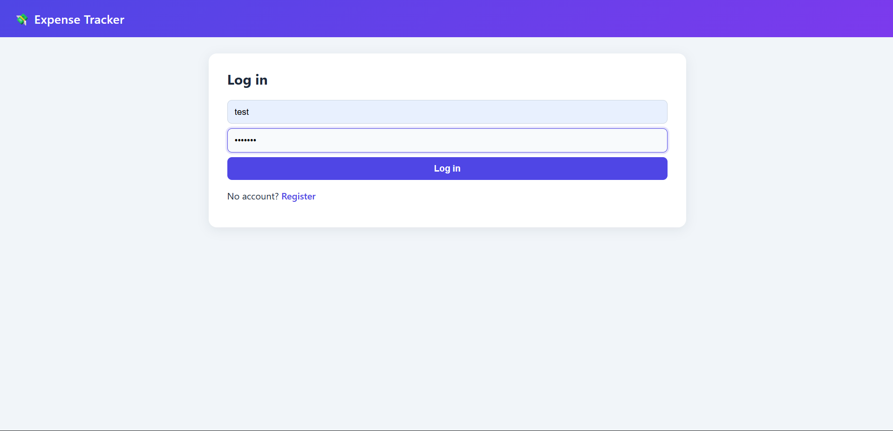
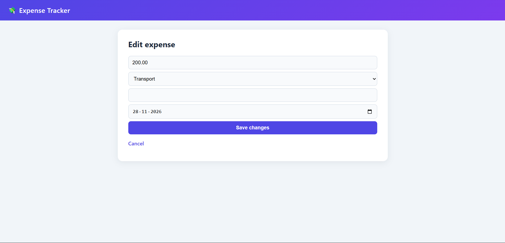

# 💸 Expense Tracker with Analytics Dashboard

A full-stack web app to track personal expenses and visualise spending patterns. Users sign up, log expenses, and see monthly and category-wise analytics on a dashboard.

**🔗 Live demo:** https://expensetracker-ac2i.onrender.com

> Hosted on a free tier, so the first load after a period of inactivity can take about a minute while the server wakes up.

**Demo login:** username `test` / password `test123`

## Screenshots

### Dashboard



### Analytics charts and expense management

| Charts | Add expense and list |
|---|---|
|  |  |

### Login and edit

| Login | Edit expense |
|---|---|
|  |  |

## Features

- User registration and login with hashed passwords (Werkzeug) and session management (Flask-Login)
- Add, edit and delete expenses (full CRUD)
- Each user can only see and modify their own data
- Dashboard with:
  - Bar chart of total spending over the last 6 months
  - Doughnut chart of this month's spending by category
  - Current month's total
- Input validation on amount, date and category
- PostgreSQL database, deployed live with continuous deployment from GitHub

## Tech Stack

| Layer | Technology |
|---|---|
| Backend | Python, Flask |
| Database | PostgreSQL (Neon), SQLAlchemy ORM |
| Auth | Flask-Login, Werkzeug password hashing |
| Frontend | Jinja2 templates, HTML, CSS, Chart.js |
| Deployment | Render (web service), Gunicorn |

## Database Schema

- **User**: `id`, `username` (unique), `password_hash`
- **Expense**: `id`, `amount`, `category`, `description`, `date`, `user_id` (foreign key to User)

One user has many expenses. Deleting a user cascades to their expenses.

## Run Locally

```bash
git clone https://github.com/Stellarlaunch/ExpenseTracker.git
cd ExpenseTracker
python -m venv venv
venv\Scripts\activate        # Windows
# source venv/bin/activate   # macOS / Linux
pip install -r requirements.txt
```

Create a `.env` file in the project root:

```
SECRET_KEY=your-random-secret-key
DATABASE_URL=sqlite:///expenses.db
```

For PostgreSQL, set `DATABASE_URL` to your PostgreSQL connection string instead.

Run the app:

```bash
python app.py
```

Then open http://127.0.0.1:5000

## Project Structure

```
ExpenseTracker/
├── app.py              # Flask app, models and routes
├── requirements.txt
├── templates/
│   ├── base.html       # Shared layout and styling
│   ├── login.html
│   ├── register.html
│   ├── dashboard.html  # Charts, add form, expense table
│   └── edit_expense.html
└── screenshots/
```

## Possible Improvements

- Date range filters and CSV export
- Monthly budgets with overspend alerts
-